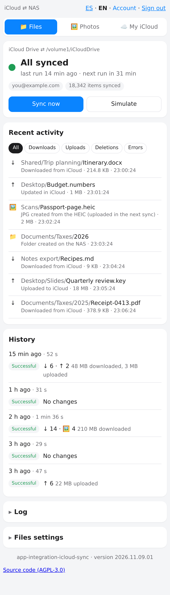
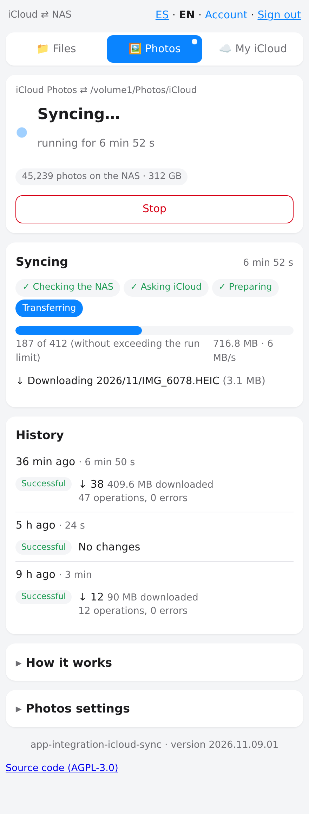
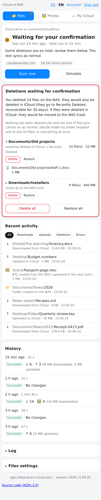
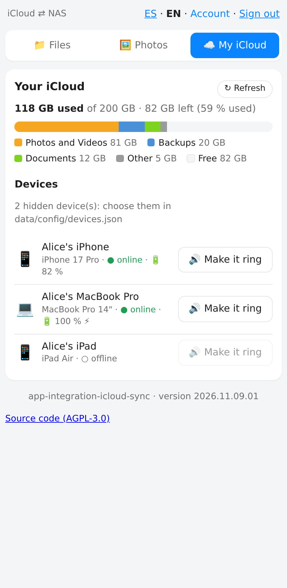

> **Not affiliated with, endorsed by or sponsored by Apple Inc. iCloud is a trademark of Apple Inc.** This project uses an undocumented interface and may stop working at any time; use it at your own risk.

[Leer en español](README.es.md)

# icloud-nas-mirror

Self-hosted **two-way sync between iCloud Drive / iCloud Photos and a folder on your NAS or server**, with a web panel, 2FA login and safety limits. One Docker container, `amd64` and `arm64`.

> **Status: beta.** It has run for weeks on the author's own account, but it relies on an interface Apple does not document or support. Read [Risks](#risks-read-this-first) before using it.
> The web panel and the e-mails come in **English and Spanish**: switch with **ES · EN** at the top of the panel (it follows your browser language by default), and set `NOTIFY_LANG` for e-mails. Logs are in English. The names of the folders and files the app creates on disk (`Albums/`, `Hidden/`, `Upload/`, `(edited)`, `(NAS conflict …)`) are chosen with `NAMES_LANG` (`en` or `es`): pick it **before the first sync**, because those names are stored in the state databases.

<p align="center">
  
  
  
  
</p>

<p align="center"><sub>Sample data. The panel follows your browser language (ES · EN).</sub></p>

## What it does

**iCloud Drive ⇄ a folder** (two ways)
- Changes on either side are propagated. Conflicts keep both copies (`name (NAS conflict YYYY-MM-DD HHMM).ext`; `conflicto NAS` with `NAMES_LANG=es`).
- Nothing is lost silently: deletions go through a trash (`data/trash/`, 30 days by default) and iCloud's *Recently Deleted*.
- More than `CONFIRM_DELETES_OVER` deletions in one run **wait for your confirmation** in the panel.
- Optional: a `photo.jpg` next to every `photo.heic` (high quality, EXIF/GPS/colour profile kept; the HEIC is never touched).
- App libraries (Pages, Numbers, Keynote, Shortcuts…) are copied iCloud → disk, one way.

**iCloud Photos ⇄ `Photos/iCloud/YYYY/MM/`** (two ways)
- Originals, edited versions (`… (edited)`), Live Photo videos, and your albums (as hard links under `Albums/<album>/`). With `NAMES_LANG=es` these are `(editada)` and `Álbumes/`.
- Hidden photos can go to their own folder, outside your photo manager's library.
- Put files in `Upload/` (`Subir/` with `NAMES_LANG=es`) to upload them to iCloud Photos. Deleting a photo on disk deletes it in iCloud (with confirmation above the limit).
- Built to be gentle with your account: per-run limits (downloads, GB, uploads, deletions), pauses between transfers, automatic back-off when Apple slows down, random sampling so a few slow files never block the rest.

**Operation**
- Web panel: status, live progress, activity, conflicts, history, pending deletions, storage and devices. Mobile friendly.
- Login with password + TOTP (authenticator app) and recovery codes; progressive IP lockout. See [Security](#security).
- Watchdog: a run that stops making progress is stopped, you get an e-mail, and the process restarts if it does not answer.
- Optional e-mail notifications (failure, recovery, pending 2FA, conflicts).

## Quick start

You need Docker with Compose, a folder for the data, and an Apple ID.

```bash
git clone https://github.com/frodcab/icloud-nas-mirror.git
cd icloud-nas-mirror
cp .env.example .env            # edit ICLOUD_USERNAME, PUID/PGID, the folders and TZ
mkdir -p data drive home
printf 'ICLOUD_PASSWORD=your-apple-password\nGUI_PASS=a-long-panel-password\n' > data/secrets.env
chmod 600 data/secrets.env
docker compose up -d
```

Open `http://<host>:8096`, log in as `admin` with the `GUI_PASS` you chose, and set up your authenticator app. Apple will send a verification code to your devices: enter it in the panel. Sync stays paused until you do.

**First run, recommended**
1. Leave `DRY_RUN=true` and `PHOTOS_DRY_RUN=true`. The logs and the panel show what *would* happen.
2. Try a small folder first: `SYNC_FOLDERS=Some/Test/Folder`.
3. When it looks right, set both to `false` and restart: `docker compose up -d`.

The image is published at `ghcr.io/frodcab/icloud-nas-mirror`. Tags: the version (e.g. `2026.11.07.01`) and `latest`.

## How Drive decides what to do

| On disk | In iCloud | Action |
|---|---|---|
| unchanged | changed or new | download |
| changed or new | unchanged | upload |
| changed | changed | conflict: both are kept |
| deleted | unchanged | delete in iCloud (stays 30 days in *Recently Deleted*) |
| unchanged | deleted | move to the local trash |

Safeguards: an empty side that would wipe the other (unmounted volume, broken answer from Apple) aborts the run; the first sync never deletes; isolated errors are retried next run.

## Configuration

Everything is an environment variable; see [`.env.example`](.env.example) and [`compose.yml`](compose.yml). The important ones:

| Variable | Default | What it is |
|---|---|---|
| `ICLOUD_USERNAME` | required | Apple ID |
| `ICLOUD_PASSWORD`, `GUI_PASS`, `SMTP_PASSWORD` | in `data/secrets.env` | secrets, never in the compose file |
| `DRY_RUN` / `PHOTOS_DRY_RUN` | `true` in the compose | only log what would happen |
| `SYNC_FOLDERS` | empty = all | iCloud Drive folders to sync, comma-separated |
| `SYNC_INTERVAL_MIN` / `PHOTOS_INTERVAL_MIN` | 45 / 240 | minutes between runs |
| `CONFIRM_DELETES_OVER` | 5 | more deletions than this wait for confirmation |
| `PHOTOS_MAX_DOWNLOADS`, `PHOTOS_MAX_GB`, … | 1000, 10 | per-run limits for Photos |
| `PHOTOS_HIDDEN`, `PHOTOS_HIDDEN_DIR` | true, empty | download hidden photos, and where |
| `HEIC_TO_JPG` | true | JPG next to each HEIC |
| `AUTH_ALLOW_NETWORKS` | `192.168.0.0/16` | networks never locked out |
| `PUID` / `PGID` | 1000 / 1000 | owner of the files written |

## Security

- The panel has its own login: password (argon2id) + TOTP with anti-reuse, 10 recovery codes, `HttpOnly`/`SameSite=Strict` session cookies, anti-CSRF checks and progressive IP lockout.
- `X-Forwarded-For` is only trusted from the container's gateway. Put the panel behind a reverse proxy with HTTPS if you expose it beyond your LAN.
- Your Apple password lives only in `data/secrets.env` (mode 600) and in memory. Apple's session cookies are kept in `data/session/`. **Protect the `data/` folder like a password manager.**
- Use a long, unique `GUI_PASS`; you can change it from the panel afterwards.
- **Running without the login.** If you already protect the panel (a VPN such as Tailscale/WireGuard, or a reverse proxy with its own
  authentication such as Authelia/Authentik), set `AUTH_DISABLED=true`. There is then no user, password or TOTP, and no *Account* page. This is
  **off by default** and it is a real trade-off: anyone who can reach the port can confirm deletions, enter your Apple 2FA code or play a sound
  on your devices. Safeguards that stay on: only private networks (`10/8`, `172.16/12`, `192.168/16`, loopback, `100.64/10`) are accepted unless you set
  `AUTH_ONLY_NETWORKS` (or `AUTH_ALLOW_PUBLIC=true`, your responsibility); the anti-CSRF check stays; and the `Host` header must be an IP, a
  local name (`nas`, `*.local`, `*.lan`) or one you list in `AUTH_ALLOWED_HOSTS`/`PUBLIC_URL` (protection against DNS rebinding). Behind a proxy that
  is not in `AUTH_TRUSTED_PROXIES` the app only sees the proxy's address, so the network check cannot protect you: do it in the proxy.
- `/health` is public and returns no personal data (version, auth state, last run status).
- Report vulnerabilities as described in [SECURITY.md](SECURITY.md).

## Risks (read this first)

- **Unofficial.** There is no public iCloud API. This project talks to the same web interface as icloud.com, through [pyicloud](https://github.com/timlaing/pyicloud). Apple can change it without notice and break the app, and its terms of service do not authorise this kind of access. **You use it at your own risk; Apple may restrict an account that behaves unusually.** That is why the limits and the back-off exist; do not raise them blindly.
- **Two-way means deletions propagate.** Test with `DRY_RUN=true` and a small folder first, keep your own backups, and read the pending-deletions prompts carefully.
- iCloud accounts with *Advanced Data Protection* must enable *Access iCloud Data on the Web* on the iPhone. Physical security keys (FIDO2) are not supported.
- No warranty of any kind (see the licence).

## Updating

```bash
docker compose pull && docker compose up -d
```

Back up `data/` (sessions, state, users). Losing it only means logging in to Apple again; your files are on disk and in iCloud.

## Troubleshooting

- *Stuck at "waiting for 2FA"*: open the panel and enter the code Apple sent. Sessions expire every few weeks.
- *Apple rejects the password*: the app does **not** retry by itself (repeated failures can lock the account). Fix `data/secrets.env` and press "Reconectar" in the panel.
- *Permission errors on the folders*: set `PUID`/`PGID` to the owner of `drive/` and `home/`.
- *Slow Photos first run*: it is limited on purpose (1000 files / 10 GB per run). A 200 GB library takes a couple of days.
- Logs: `docker compose logs -f`. When reporting a problem, **remove emails, paths with personal names and any code or token** first.

## Contributing

Issues and suggestions are welcome. Pull requests are **not accepted for now** (the project is small and changes licence terms are hard to coordinate); this may change.

## Roadmap

- More interface languages (a language is one `static/i18n-<code>.json` file; translations are welcome as issues).
- A short video in this README.
- More tests against real accounts before each release.

## Licence

Copyright (C) 2026 F. Javier R. Cabero

Licensed under the **GNU Affero General Public License v3.0 only** ([LICENSE](LICENSE)). If you modify this software and let others use it over a network, you must offer them the source of your version; the panel footer links to this repository for that reason. Third-party software and its licences: [NOTICE](NOTICE).
